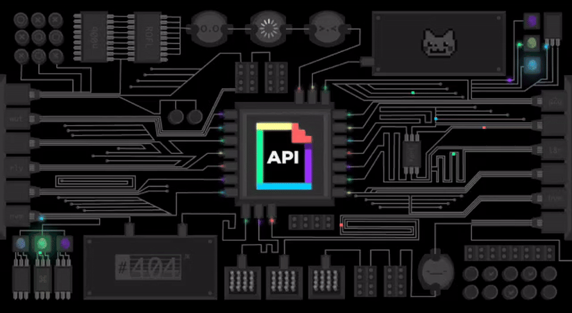
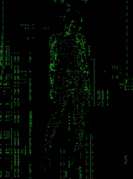

  
   

  

    
  

  

    
    
    
    
  

---

  

## 👩‍💻 About Me

🎓 **Master's Student in Intelligent Systems** — **Belgorod State Technological University (BSTU), Russia** | **2026–Present**

**Software Engineer** with a strong academic background in Software Engineering and specialized expertise in **Big Data Analysis, Machine Learning, and Artificial Intelligence**. Hands-on experience building scalable Java and Spring Boot applications, microservices architecture, and event-driven systems with Apache Kafka. Skilled in machine learning classification models, containerization (Docker, Kubernetes), and modern software engineering practices.

🎓 **B.Sc. in Software Engineering** — **Belgorod State Technological University named after V.G. Shukhov (BSTU), Russia** — **GPA: 4.92/5.0, Graduated with Honors (2026)**

**Final Qualification Work (Bachelor's Thesis): Development of a Resume Evaluation System for an IT Company**

Completed during an internship at **"ТЕХНОЛОГИИ НАДЕЖНОСТИ"**.

- Designed and developed an automated Machine Learning system for evaluating and ranking resumes for IT recruitment.
- Applied Natural Language Processing (NLP) and data processing techniques to extract candidate qualifications and match them against technical job requirements.
- Implemented an optimized resume-ranking pipeline capable of processing and ranking approximately **15,000 resumes in 3 seconds** under the tested environment.
- Developed two interactive interfaces using **Streamlit**:
  - **HR Dashboard:** Enables HR professionals to review resumes, evaluate candidates, and rank applicants based on job requirements.
  - **Developer Dashboard:** Allows developers to configure evaluation criteria, adjust their weights, and customize the candidate-ranking algorithm.
- Designed relational database schemas and optimized evaluation algorithms to support efficient and consistent candidate screening.

🎓 **Additional Professional Program** — **Belgorod State Technological University (BSTU), Russia**
**Big Data Analysis, ML & AI** · **1-Year Program · 504 Hours** · **Graduated with Honors (2025)**

**Credit Scoring Task System**
`Python` · `scikit-learn` · `Pandas` · `NumPy` · `Classification` · `Decision Trees`

- Developed a machine learning classification model to assess creditworthiness and predict financial credit risk.
- Performed feature engineering, decision tree analysis, and statistical preprocessing on financial datasets.
- Evaluated and optimized model performance using **F1-score and accuracy** metrics to ensure reliability.

🌍 **Languages:** Arabic (Native) · Russian (Advanced) · English (Intermediate)

  

## 🛠️ Technical Ecosystem

<table>
<tr>
<th align="center">🏗️ Languages & Core</th>
<th align="center">🌱 Spring Ecosystem</th>
<th align="center">🧠 Machine Learning, Deep Learning & AI</th>
</tr>
<tr>
<td align="center"></td>
<td align="center"></td>
<td align="center"></td>
</tr>
</table>

 

 

  

<table>
<tr>
<th align="center">🐳 DevOps & Tools</th>
<th align="center">🌐 Web & Frontend</th>
<th align="center">💻 OS</th>
</tr>
<tr>
<td align="center"></td>
<td align="center"></td>
<td align="center"></td>
</tr>
</table>

**Spring Cloud:** Spring Cloud Gateway · Eureka Service Discovery · Feign Client · Resilience4j · Spring Config Server
**Design Patterns:** Singleton · Factory · Builder · Observer · Strategy · Proxy · Decorator · Repository · MVC · Dependency Injection
**Security & Docs:** Spring Security · Keycloak (OAuth2) · Swagger

  

  

  

## 🚀 Featured Projects

| Project | Description | Tech Stack |
| :--- | :--- | :--- |
| 🧠 [**ML Resume Ranker**](https://github.com/shroukmohamed5/ML-Resume-Ranker) AI · NLP | Bachelor's Thesis — automated ML system to evaluate & rank resumes for IT recruitment using NLP |     |
| 🚗 [**Drowsy Driver Detection & Emergency V2V**](https://github.com/shroukmohamed5/Drowsy-Driver-Detection-Intelligent-Emergency-V2V) Master's Project · Computer Vision | Real-time drowsiness detection from webcam with intelligent emergency V2V communication, simulated in CARLA and SUMO, with a live dashboard |      |
| 🛒 [**Full-Stack E-Commerce Microservices**](https://github.com/shroukmohamed5/Full-Stack-E-Commerce-System-using-Spring-Boot-Microservices-Angular) Backend · Microservices | Product, order, inventory & notification microservices with Gateway, Keycloak auth, Kafka messaging |      |
| 📨 [**Kafka Spring Boot Messaging**](https://github.com/shroukmohamed5/KAFKA-Spring-Boot-Docker-Postman-) Backend · Event-Driven | Event-driven messaging system with dedicated Kafka producer/consumer services |     |
| 👥 [**Employee Management System**](https://github.com/shroukmohamed5/Employee-Management-System) Full-Stack · Web | Full-stack app — REST API with full CRUD & RBAC authentication, Angular frontend, Dockerized |     |
| 🥐 [**Premium Boulangerie**](https://github.com/shroukmohamed5/Premium-Boulangerie) Web Application | Luxury bakery website — responsive, photo-driven design with a Java Spring Boot backend, PostgreSQL & Docker |        |

  

  

## 📊 GitHub Analytics

  
  

 

  

## 🎮 Contribution Graph

  <picture>
    <source media="(prefers-color-scheme: dark)" srcset="https://raw.githubusercontent.com/shroukmohamed5/shroukmohamed5/pacman-output/pacman-contribution-graph-dark.svg">
    <source media="(prefers-color-scheme: light)" srcset="https://raw.githubusercontent.com/shroukmohamed5/shroukmohamed5/pacman-output/pacman-contribution-graph.svg">
    
  </picture>

  

## 🎓 Education & Certifications

<table>
<tr>
<td align="center" colspan="2">

🏫&nbsp;**Belgorod State Technological University (BSTU)**&nbsp;·&nbsp;Russia

</td>
</tr>
<tr>
<td align="center" width="50%">

🏫&nbsp;**Belgorod State Technological University (BSTU)**&nbsp;·&nbsp;Russia

</td>
<td align="center" width="50%">

🏫&nbsp;**Belgorod State Technological University (BSTU)**&nbsp;·&nbsp;Russia

</td>
</tr>
</table>

 

  
    
  
   
  <b>Shrouk Mohamed</b> 
  <i>Software Engineer | Java & Spring Boot Developer | ML & Big Data</i> 
   
  

